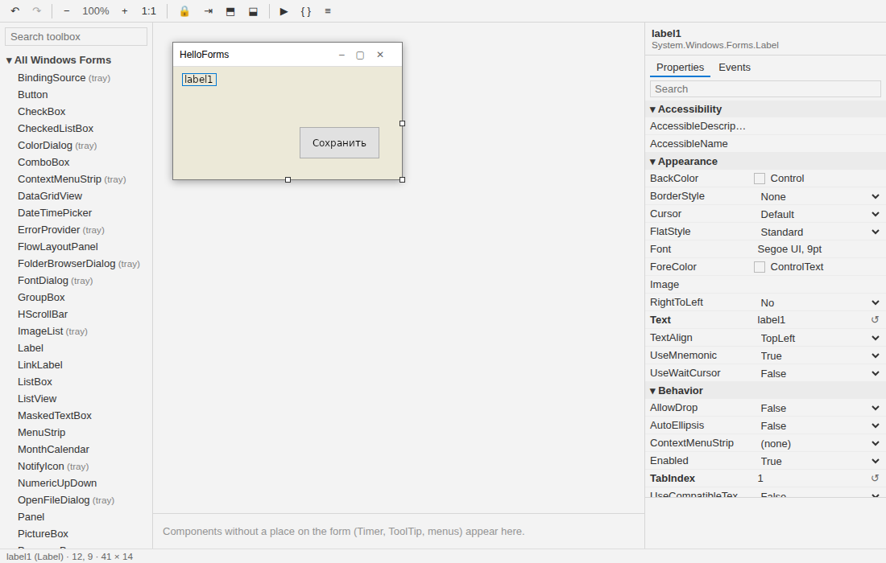

# The visual designer

The NetForms designer is a VS Code extension: **NetForms Designer** (`netforms.netforms-designer`).
It is the Windows Forms designer of Visual Studio rebuilt for VS Code, on Windows and Linux. Editing forms
works fully offline; creating projects and forms uses the NetForms templates from NuGet.

Installing it and VS Code: [Install and set up](install.md#4-vs-code-and-the-designer).

## How it works

- `*.Designer.cs` opens as a canvas (use **Open as Text** in the editor title to see the code). F7 goes to
  `MainForm.cs`, Shift+F7 back.
- The form on the canvas is painted by NetForms itself — a design-time host (`tools/NetFormsDesigner.Host`,
  bundled in the extension) reads `InitializeComponent()` with Roslyn **without compiling your project**,
  builds the live form and sends a picture to the webview.
- Every edit is written back to `*.Designer.cs` in the form Visual Studio writes (same statement order,
  same comments, same `ShouldSerialize` rules — checked against the real WinForms serializer in CI). A form
  saved here opens in Visual Studio unchanged and vice versa. The file is the only source of truth: edit
  it as text or switch branches, and the canvas reloads.
- Renaming a control renames its field, its event handlers and their uses in your code.
- **Events tab:** **+** next to an event writes a handler with the default name (`button1_Click`) into `MainForm.cs`
  and opens it — the same as a double-click on the event, or on the control for its default event; typing a name
  and pressing Enter binds a handler of your own name. **→** goes to the handler, **✕** unbinds it (the method stays
  in the code, as in Visual Studio).

## Creating projects and forms

**NetForms: Create New Project…** and **NetForms: New Form…** (also in the Explorer context menu of a folder)
run `dotnet new` with the **NetForms.Templates** package. The first time, the extension installs the template
version it is made for from NuGet (`dotnet new install NetForms.Templates::<version>`); a new project references
the **NetForms** package of the same version. A new form gets the namespace of its project plus its folders, as
in Visual Studio, and opens on the canvas.

Besides an empty form and a user control there are forms made for a purpose: a **dialog** (OK and Cancel with
`DialogResult`, `AcceptButton`/`CancelButton`, a fixed border), an **About box** (product, version, copyright and
description from the assembly attributes), a **login form** (user name and password) and a **splash screen**
(borderless, with the title, version and a progress bar). On the command line: `dotnet new netforms-dialog`,
`netforms-aboutbox`, `netforms-login`, `netforms-splash`.

## Commands

| Command | Key | What it does |
|---|---|---|
| NetForms: Open Visual Designer | | Opens `*.Designer.cs` (or the form of the current `.cs`) on the canvas. |
| NetForms: Open as Text | | The same file in the text editor. |
| NetForms: View Code | F7 | From the canvas to `MainForm.cs`. |
| NetForms: View Designer | Shift+F7 | From `MainForm.cs` to the canvas. |
| NetForms: Tidy Designer File | | Rewrites `InitializeComponent()` in the canonical form the designer writes, dropping redundant statements. |
| NetForms: Create New Project… | | A new NetForms application (see above). |
| NetForms: New Form… | | A form (empty, dialog, About box, login, splash screen) or a user control in a folder. |
| NetForms: Convert WinForms Project… | | The converter's report for a `.csproj`, then the rewrite ([Moving a WinForms project](migrating.md)). |
| NetForms: Run Project | | `dotnet run` in a terminal. |
| NetForms: Set as Startup Form | | `Application.Run` in `Program.cs` starts this form (context menu of a `*.Designer.cs`, and of the form on the canvas). |
| NetForms: Check for Updates… | | What is behind, in one list to tick: the NetForms package of the workspace's projects, the templates, this extension (from the GitHub release), the .NET SDK (its update command is typed into a terminal for you to run: it may need `sudo`). Also once a day on its own (`netforms.checkForUpdates`). |
| NetForms: Publish Application… | | `dotnet publish` for Windows or Linux (x64, ARM64), self-contained or framework-dependent, into `publish/<rid>` next to the project. |
| NetForms: Add Control Library… | | Controls from a NuGet package, a `.dll`, a local `.nupkg`/feed, another project, a folder of this project, or a package the project already references ([Control libraries](#control-libraries)). Also in the toolbox and the Explorer context menu of a `.csproj`. |
| NetForms: Remove Control Library | | Takes a library's group out of the toolbox, and its reference out of the `.csproj` if you say so. |
| NetForms: Rescan Toolbox | | Builds the project and reads its controls and libraries again (**↻** in the toolbox). |
| NetForms: Set Designer Host Path… | | Use another designer host. |
| NetForms: Check Setup | | Shows the `dotnet`, the designer host and the templates found. |

Debugging (F5) is the C# extension's: its **.NET: Generate Assets for Build and Debug** creates the `launch.json`.

## Settings

| Setting | Default | |
|---|---|---|
| `netforms.dotnetPath` | `dotnet` | The `dotnet` executable, when it is not on `PATH`. |
| `netforms.designerHostPath` | empty | Another designer host (`NetFormsDesigner.Host.dll`); empty: the one bundled with the extension. |
| `netforms.checkForUpdates` | on | Look for a newer NetForms, extension and .NET SDK once a day and say when there is one. |
| `netforms.snapToLines` | on | Snap to edges, centres and margins while dragging (hold Alt to move freely). |

## Canvas

Move and resize with the mouse or the arrow keys (Ctrl — by 8, Shift — size), snap lines, select several with
Ctrl/Shift or by drawing a rectangle over them (on the form; inside a panel or group box once it is selected — it then
moves by the ✥ glyph at its top left, as in Visual Studio; Ctrl/Shift adds to the selection), Escape selects the parent, drop into another container, Format → Align / Make Same Size / Spacing,
zoom, lock, bring to front / send to back, tab order mode (click the controls in order). Docked controls
are outlined with a dashed line and resize only from their free edge, as in Visual Studio. Components without a
place on the form (Timer, ToolTip, ImageList, menus, dialogs) go to the tray under the form. Undo and redo with
Ctrl+Z / Ctrl+Y inside the canvas.

Ctrl+C / Ctrl+X / Ctrl+V copy, cut and paste controls with everything in them (child controls, menu items, columns,
TableLayoutPanel cells), into another form too; Ctrl+D duplicates beside the original. A pasted control keeps its name
when it is free (else `button2`), and its event handlers when pasted into the same form. A right-click opens the context
menu, as in Visual Studio: View Code, Cut, Copy, Paste, Duplicate, Delete, Bring to Front / Send to Back, Lock, Select
the parent, Properties; on the form, Set as Startup Form.

A **TableLayoutPanel** is laid out by cells, as in Visual Studio. Its cells are drawn dashed; a control dropped from the
toolbox or dragged in goes to the cell under the mouse (highlighted while dragging), onto a taken cell the two controls
swap, the arrow keys move a control from cell to cell, and a full table grows a row (or a column, by `GrowStyle`).
Drag the boundary between two columns or rows to resize them. **…** next to *Columns* or *Rows* in the property grid
edits each one's size type (Absolute — pixels, Percent — a share of the space left, AutoSize — fits its controls) and
size, and inserts, removes and reorders them: the controls go along with their columns, and those of a removed column
move to free cells (they are never deleted with it). A right-click in a table inserts or deletes the column or row
under the mouse. A control in a table has *Column*, *Row*, *ColumnSpan* and *RowSpan* in the property grid; the
designer writes every control of a table it edits as `Controls.Add(control, column, row)`.

A click on a tab header of a TabControl shows that page, so each page is laid out in turn (written as
`SelectedIndex`, as Visual Studio does). **…** next to TabPages, a strip's Items, DropDownItems or Columns opens the
collection editor: the elements by their captions, with add, remove (a tab page with its controls), move up and
down; `-` adds a menu separator. For a strip's items the kind of each new one is picked beside it — button, label,
split or drop-down button, separator, combo box, text box, progress bar (what Visual Studio offers for that strip);
*Edit Items…* / *Edit DropDownItems…* in the context menu opens the editor.

The columns of a **DataGridView** and of a **ListView** (in *Details* view) are selected by a click on their headers and
edited in the property grid: `Width`, `DataPropertyName`, `ReadOnly`, the cell style and the rest; **ColumnType** changes
a DataGridView column to a check box, combo box, button, image or link column, keeping its name and settings. Click the
grid's body to select the grid itself (or press Escape on a column).

A **FlowLayoutPanel** goes by order, not by coordinates: a control added to it goes at the end, a control dropped or
dragged into it goes where the mark between the controls shows, a drag inside it reorders the flow, and the arrow keys
move the selected control back or forth in it.

A **TreeView**'s *Nodes* (**…**) open the TreeNode Editor, as in Visual Studio: the nodes as a tree — *Add Root*,
*Add Child*, delete, move up and down, out (a sibling of its parent) and in (a child of the node above) — and the
selected node's `Text`, `Name`, `ImageKey`, `SelectedImageKey` and `StateImageKey` (from the tree's ImageList, with
thumbnails), `Tag`, `ToolTipText` and `Checked`. *As text…* edits the texts as indented lines instead.

**▾** beside `Anchor`, `Dock`, a color or a font opens Visual Studio's editor for it: four bars around a box for
`Anchor`, the six places for `Dock`, a color picker with *Custom* (a palette), *Web* and *System* colors, and the font's
family, size and style with a sample. A button given a color of its own gets `UseVisualStyleBackColor = false`, as in
Visual Studio, so the color shows.

**Data binding** is set in the property grid, as in Visual Studio. `DataSource` (of a BindingSource, a DataGridView, a
ComboBox, a ListBox) lists the form's binding sources and the **classes of the project** (its build output is loaded
as for its own controls — build it first): a class picked for a BindingSource becomes `DataSource = typeof(Customer)`;
picked for a grid or a list it gets a `customerBindingSource` of its own (or the one the form has for that class), and
a grid gets a column for each property (`nameDataGridViewTextBoxColumn`, a check box column for a `bool`).
`DisplayMember`, `ValueMember`, `DataMember` and a column's `DataPropertyName` suggest the data source's properties.
The **(DataBindings)** group binds a control's bindable properties (`Text`, `Tag`, `Checked`, `Value`,
`SelectedValue`…) to a property of a binding source: *customerBindingSource - Name* writes
`textBox1.DataBindings.Add(new Binding("Text", customerBindingSource, "Name", true))`.

A **SplitContainer**'s splitter is dragged on the canvas, as in Visual Studio: a bar follows the mouse and
`SplitterDistance` is set when it is let go (not while `IsSplitterFixed` is on or a panel is collapsed).

A **ToolStripContainer** is designed as in Visual Studio: tool strips (ToolStrip, MenuStrip, StatusStrip) go into its
four side panels and everything else into its middle (`ContentPanel`); with the container selected, a click in the
toolbox puts a strip into the top panel and a control into the middle. A strip joins the row it is dropped on, or a new
row when dropped on the band past the last one; drag it to another place, row or side. While designed, an empty top
panel keeps 25 pixels to drop onto, the other panels and the band past the last row 8 (at run time an empty panel takes
no room). Hide a side with `TopToolStripPanelVisible` and its kin.

Pictures and icons — `Image`, `BackgroundImage`, a form's `Icon`, a menu item's `Image` — are picked from a file with
**…** in the property grid (**✕** clears one; the grid shows a thumbnail) and kept in the form's `.resx`, as Visual
Studio keeps them: `button1.Image = (Image)resources.GetObject("button1.Image")`. An **ImageList**'s *Images* (**…**)
are added from files, named, reordered and removed; the list's `ImageStream` goes to the `.resx` too. A localizable
form (`Localizable = true`) is still shown but not written (its properties live in the `.resx` per culture).

Menus open on the canvas, as in Visual Studio: a click on a menu item shows its drop-down under it (a sub-menu opens to
the right), and a **ContextMenuStrip** selected in the tray opens at the top left of the form. Every item in them can be
selected — double-click one to write its `Click` handler, or set `ShortcutKeys`, `Checked`, `Image` and its own
`DropDownItems` in the property grid. Selecting anything else closes the menus.

A **ToolTip**, **HelpProvider**, **ErrorProvider** or **FlowLayoutPanel** gives the controls properties of its own, listed
in the grid by its name — *ToolTip on toolTip1*, *HelpString on helpProvider1*, *Error on errorProvider1*, *FlowBreak on
flowLayoutPanel1* — and written as `toolTip1.SetToolTip(button1, "...")`.

A **BindingNavigator** dropped on a form comes with its standard items (first, previous, position, count, next, last,
add, delete), each a component of the form named as in Visual Studio (`bindingNavigatorMoveFirstItem`, …); set its
`BindingSource` in the property grid. A **HelpProvider** adds *HelpString*, *HelpKeyword*, *HelpNavigator* and *ShowHelp*
to every control of the form, as the ToolTip adds *ToolTip on toolTip1*. The printing components (*Printing* group:
PrintDocument, PrintDialog, PageSetupDialog, PrintPreviewDialog) go to the tray; `PrintPreviewControl` goes on the form.

## Control libraries

Step by step, with the check, `.vscode/netforms.json` and writing a library of your own: **[Control libraries in the
designer](control-libraries.md)**.

The toolbox has the project's own controls, as Visual Studio's **<Project> Components** group: every public control,
user control and component of the project (not its forms) from the **last successful build**. After a build - in the
terminal, F5 or **↻** in the toolbox - the designer reloads them by itself; a control added since the last build stays a
placeholder with its type name until the next one.

Other libraries are added with **NetForms: Add Control Library…** (the **+ Control Library…** button in the toolbox);
nothing is installed on its own when a form opens or a control is dropped. The sources:

| Source | What happens to the project |
|---|---|
| NuGet package | Search nuget.org, pick a version; the package is downloaded and checked first, then `dotnet add package`. |
| `.dll` file | A `<Reference>` with a `HintPath`; the file is copied into `libs/` of the project so it builds elsewhere too. |
| `.nupkg` or a local feed | The folder becomes a package source in the project's `nuget.config`, then as a NuGet package. |
| Folder of this project | Nothing: the controls of that folder (its namespace) get a toolbox group of their own. |
| Another project | `dotnet add reference`; its controls follow its builds. |
| NuGet package already in the project | Nothing: you pick which packages to show. |

Before a library is added, its assemblies are read **without running any of its code**: built for NetForms - added; built
for the real System.Windows.Forms - a warning (the project may not compile on Linux); native parts for Windows only - a
warning; built for the .NET Framework or without a .NET 10-compatible framework - not added, with the reason. Then it
lists the controls and components it found, with their `[ToolboxBitmap]` icons; untick the ones the toolbox should not show.

References live in the `.csproj`; the toolbox groups in **`.vscode/netforms.json`** (commit it, and colleagues get the same
toolbox). A library whose reference has left the `.csproj` is hidden, not an error. Libraries added before are offered
first in the next project.

A library's code runs in the designer host, as it does in Visual Studio. In a folder you have not trusted (Restricted
Mode) the toolbox lists the controls from their metadata only: none of their code is loaded, and nothing can be added.
A control whose constructor or `OnPaint` throws is drawn as a red cross with the error - the form still opens and
nothing of it is lost. The assemblies are loaded from a copy, so the next build is never blocked by a locked `.dll`.

## Not yet

- Editing a `Localizable = true` form (such forms open read-only with an explanation).
- Design-time extras of third-party libraries: their own designers (`[Designer]`, smart tags) and `UITypeEditor`s.
  Their `TypeConverter`s work. How the libraries are loaded (in Russian): [designer-control-libraries.md](designer-control-libraries.md).

## Language

The interface follows the VS Code display language: English or Russian. Toolbox groups and property
categories are named as in the Russian Visual Studio; property descriptions come from WinForms and stay in
English.
